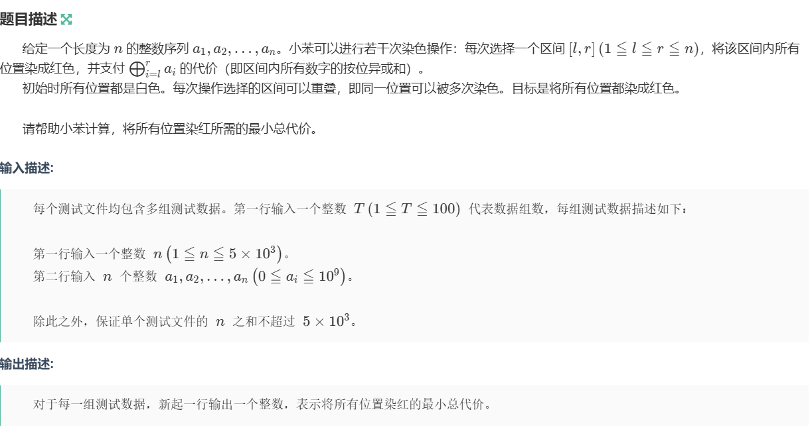

本质是：
1.明确我要找到的目标：(比方说是在第n个状态时需要计算max,min);
2.思考：
（从递推的角度出发：直接算第n个状态时不太可能，因为这一个状态时从之前的所有的合法状态转移取max或min而来，有点像是数学中数列多线路的递推公式），想清这个状态是如何由之前的状态转移得到

3.想请便可以以递推的想法由下到上的解决；
4.初始底层状态
5.思考在高层状态是怎么由底层状态转移而来，从而找到并枚举之前所有合法的状态；
6.到达题目的top状态，根据题目意思得出答案

# 例题1 :  线性dp - 样例

## 相关链接：

- 题目链接：[D-小苯的序列涂色_牛客周赛 Round 137](https://ac.nowcoder.com/acm/contest/130843/D

## 题目：


## 思路：
## 提问 - 到第n个位置时的最小总代价？

我们可以先解决的在前i个位置时的最小的总代价：
`dp[i]` 时表示前i个位置时的最小的总代价；
转移方程 :$$dp[i] = acc[i] \ \oplus \  acc[j - 1] + mn;$$ 
其中，j作为左端点，`acc[i] ^ acc[j - 1]`表示的是从j到i的异或和；

**mn这是将左端点向左枚举，同时维护dp(min)值，因为每一个块可以重复染色；
将左区间枚举完成，维护min情况，递推到第n层即可；**

## 代码展示：

```c++
#include <bits/stdc++.h>
using namespace std;
#define int long long
const int mod = 1e9 + 7;
const int N = 3e5 + 7;

void solve() {
    int n;
    cin >> n;
    vector<int> a(n + 1),acc(n + 1);
    //对于要求连续区间的异或值，需要建立一个异或前缀和
    for(int i = 1;i <= n;i++) {
        cin >> a[i];
        acc[i] = acc[i - 1] ^ a[i];
    }
    //
    vector<int> dp(n + 1,1e18);
    dp[0] = 0;
    for(int i = 1;i <= n;i++) {
        int mn = 1e18;
        for(int j = i;j >= 1;j--) {
            mn = min(mn,dp[j - 1]);
            dp[i] = min(dp[i],(acc[i] ^ acc[j - 1]) + mn);
        }
    }
    cout << dp[n] << endl;
    return;
}
```


## 例题2 ：线性dp - 状态设计

## 相关链接：

- 题目链接：[P17521 [ECUSTPC 2026 Fall] 天外来物 - 洛谷](https://www.luogu.com.cn/problem/P17521?contestId=356798)

## 题目：


## 思路：

### 线性 DP 状态设计与题解

本题可以通过将采集过程转化为**边方向选择**的模型，利用线性动态规划完美解决。

### 一、 状态定义

我们从左到右处理水晶之间的边。用 `0` 表示边向右（$\rightarrow$），用 `1` 表示边向左（$\leftarrow$）。

定义 $dp[i][dir_{out}]$ 表示考虑前 $i$ 个水晶时，右侧边 $(i, i+1)$ 的方向为 $dir_{out}$ 时的最大得分：

- **$dp[i][0]$**：边 $(i, i+1)$ 朝右（$i \rightarrow i+1$）时，前 $i$ 个水晶的最大得分。
    
- **$dp[i][1]$**：边 $(i, i+1)$ 朝左（$i \leftarrow i+1$）时，前 $i$ 个水晶的最大得分。


### 二、 边界条件 ($i = 1$)

特殊情况：当 $n = 1$ 时，水晶没有邻居，答案直接为 $a_1$。

对于一般情况下的 $i = 1$（考虑边 $(1, 2)$ 的方向）：

- 若边 $(1, 2)$ 朝右（$1 \rightarrow 2$，即 $dir_{out} = 0$）：水晶 $1$ 的入度为 $0$，贡献 $+a_1$，即：
    
    $$dp[1][0] = a_1$$
    
- 若边 $(1, 2)$ 朝左（$1 \leftarrow 2$，即 $dir_{out} = 1$）：水晶 $1$ 的入度为 $1$，贡献 $-a_1$，即：
    
    $$dp[1][1] = -a_1$$


### 三、 状态转移 ($2 \le i < n$)

我们要由左侧边 $(i-1, i)$ 的方向（记为 $dir_{in} \in \{0, 1\}$）转移到右侧边 $(i, i+1)$ 的方向（记为 $dir_{out} \in \{0, 1\}$）：

1. **左侧贡献**：
    
    - 若 $dir_{in} == 0$（即 $i-1 \rightarrow i$），则左边为水晶 $i$ 提供 $1$ 个入度；
        
    - 若 $dir_{in} == 1$（即 $i-1 \leftarrow i$），则左边提供 $0$ 个入度。
        
2. **右侧贡献**：
    
    - 若 $dir_{out} == 0$（即 $i \rightarrow i+1$），则右边提供 $0$ 个入度；
        
    - 若 $dir_{out} == 1$（即 $i \leftarrow i+1$），则右边为水晶 $i$ 提供 $1$ 个入度。
        

由此，位置 $i$ 的**总入度**为：

$$\mathrm{in\_deg} = (dir_{in} == 0) + (dir_{out} == 1)$$

根据题目规则，入度的奇偶性决定了水晶最终的符号：

- 若 $\mathrm{in\_deg}$ 为偶数（$0$ 或 $2$），权值为 $+a_i$；
    
- 若 $\mathrm{in\_deg}$ 为奇数（$1$），权值为 $-a_i$。
    

**状态转移方程**：

$$dp[i][dir_{out}] = \max_{dir_{in} \in \{0, 1\}} \Big( dp[i-1][dir_{in}] + (\mathrm{in\_deg} \bmod 2 == 0 \ ?\ a_i : -a_i) \Big)$$


### 四、 终点与最终答案 ($i = n$)

第 $n$ 个水晶只有一条来自左侧的入边 $(n-1, n)$，而没有右侧边：

- 若 $dir_{in} == 0$（$n-1 \rightarrow n$）：入度为 $1$（奇数），贡献 $-a_n$。
    
- 若 $dir_{in} == 1$（$n-1 \leftarrow n$）：入度为 $0$（偶数），贡献 $+a_n$。
    

因此，遍历完前 $n-1$ 个水晶后，最终的最大总得分为：

$$\max(dp[n-1][0] - a_n, dp[n-1][1] + a_n)$$

## 代码展示：

```c++
#include <bits/stdc++.h>
using namespace std;
#define int long long
#define endl '\n'
#define ctz __builtin_ctzll         // 二进制表示中末尾连续0的个数
#define clz __builtin_clzll         // 二进驻表示中先导0的个数
#define count1 __builtin_popcountll // 二进制表示中1的个数
const int mod = 1e9 + 7;
const int MOD = 998244353;
const int N = 2e5 + 7;

void solve() { 
    int n;
    cin >> n;
    vector<int> a(n);
    for(int i = 0;i < n;i++) cin >> a[i];
    if(n == 1) {
        cout << a[0] << endl;
        return;
    }
    vector<vector<int>> dp(n - 1,vector<int>(2));
    // 0 : right ;
    // 1 : left ;
    dp[0][0] = a[0];
    dp[0][1] = -a[0];
    for(int i = 1;i < n - 1;i++) {
        for(int j = 0;j < 2;j++) {
            for(int k = 0;k < 2;k++) {
                int cnt = (j == 1 ? 1 : 0) + (k == 0 ? 1 : 0);
                int res = (cnt & 1 ? -1 : 1);
                dp[i][j] = max(dp[i][j], dp[i - 1][k] + res * a[i]);
            }
        }
    }
    cout << max(dp[n - 2][0] - a[n - 1], dp[n - 2][1] + a[n - 1]) << endl;
    return;
}
signed main() {
    ios::sync_with_stdio(false);
    cin.tie(nullptr);
    cout.tie(0);
    int T = 1;
    cin >> T;
    while (T--) {
        solve();
    }
    return 0;
}
```